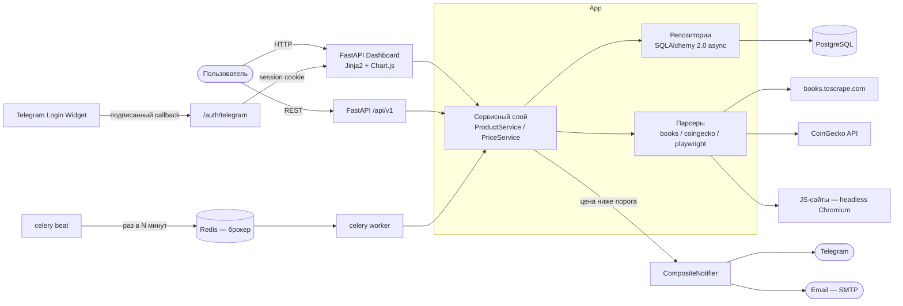

# Price Tracker


[](LICENSE)

Добавляешь товар и целевую цену — дальше сервис сам раз в несколько
часов обходит источники, копит историю и стучится в Telegram, когда
цена падает ниже порога. В браузере — дашборд с графиком, на котором
видно, как цена двигалась.

Источники беру только с разрешённым доступом: books.toscrape.com,
CoinGecko API, плюс headless Chromium для JS-сайтов. Ozon и
Wildberries не поддерживаю сознательно — жёсткий anti-bot и ToS,
подробности в разделе «Источники данных».

## Что умеет

- Отслеживание цен: books.toscrape.com, криптовалюты CoinGecko,
  произвольные JS-сайты через Playwright (Chromium, URL + CSS-селектор).
- Периодический обход активных товаров — Celery beat + worker
  в отдельных контейнерах, Redis как брокер.
- История цен по каждому товару.
- Алерт при падении до/ниже целевой цены — Telegram **и/или** email
  (SMTP), с cooldown 24 часа, чтобы не спамить.
- Веб-дашборд с авторизацией через Telegram Login Widget: таблица
  товаров со статусами, карточка с графиком (Chart.js), формы
  добавления/обновления/удаления.
- REST API `/api/v1` для интеграций и тестов (открытый — см. limitations).
- Принудительный refresh товара кнопкой или через API — удобно для демо.

## Архитектура



Слои: `api` (роутеры) → `services` (бизнес-логика) → `repositories`
(доступ к БД) → `models` (SQLAlchemy). Парсеры изолированы за
абстракцией `BaseParser`; периодическая задача Celery вызывает тот же
`PriceService.refresh_product`, что и API/dashboard.

## Стек

- Python 3.11+, FastAPI, Pydantic v2 + pydantic-settings
- SQLAlchemy 2.0 (async) + asyncpg (Postgres) / aiosqlite (тесты)
- Alembic (async-миграции)
- httpx + BeautifulSoup4 (парсинг), Playwright (JS-рендеринг, опционально)
- Celery 5 + Redis (периодические задачи, отдельные контейнеры)
- Jinja2 + Chart.js (CDN, без сборки фронта)
- aiogram 3.x (Telegram-алерты), aiosmtplib (email-алерты),
  itsdangerous (сессии для Telegram Login Widget)
- pytest + pytest-asyncio + respx (моки httpx)
- Docker + docker-compose, ruff + black + isort, pre-commit, GitHub Actions

## Ядро (стабильное)

- FastAPI + SQLAlchemy 2.0 async + Alembic
- Парсеры: books.toscrape.com (HTML), CoinGecko (REST)
- Jinja2 + Chart.js дашборд с графиком истории
- Celery worker + beat для периодического обхода
- Уведомления в Telegram с cooldown
- pytest + respx, coverage ≥ 70%

## Расширения (опционально)

- Playwright + Chromium для JS-сайтов (профиль docker compose)
- Email-алерты через SMTP
- Telegram Login Widget (AUTH_ENABLED=true)
- Demo-режим без авторизации (AUTH_ENABLED=false)

## Структура проекта

```
price-tracker/
├── app/
│   ├── api/            # роутеры: products, health, dashboard, auth
│   ├── services/       # бизнес-логика: ProductService, PriceService
│   ├── repositories/   # доступ к БД: ProductRepository, PriceHistoryRepository
│   ├── models/         # SQLAlchemy: Product, PriceHistory, ProductSource
│   ├── schemas/        # Pydantic: ProductCreate, ProductRead, PricePoint
│   ├── parsers/        # base (ABC+исключения), books_toscrape, coingecko,
│   │                   # playwright_js (headless Chromium)
│   ├── notifiers/      # telegram, email, composite (оба канала сразу)
│   ├── scheduler/      # jobs.py (async-логика) + celery_app.py (beat/worker)
│   ├── templates/      # index.html, product.html, login.html
│   ├── static/         # style.css
│   ├── core/           # config, logging, exceptions
│   ├── db/             # session, base (UTCDateTime)
│   └── main.py         # сборка FastAPI (lifespan, middleware, handlers)
├── alembic/            # async-миграции
├── tests/              # pytest: парсеры, API, дашборд, auth, нотификаторы,
│                       # scheduler/cooldown, celery wiring
├── .github/workflows/  # CI: ruff, black, isort, pytest --cov
├── Dockerfile          # multi-stage, non-root, Chromium для Playwright
├── docker-compose.yml  # db + redis + app + worker + beat
├── Makefile            # up, down, migrate, test, lint, shell-db
└── pyproject.toml      # зависимости + конфиги инструментов
```

## Быстрый старт

```powershell
cp .env.example .env        # или: Copy-Item .env.example .env
docker compose up --build -d
docker compose exec app alembic upgrade head   # или: make migrate
```

Открыть http://127.0.0.1.nip.io (порт 80 — так требует Telegram Login
Widget, см. ниже) или http://localhost. Swagger API: /docs.

### Самый быстрый запуск (без Telegram Login)

Для локального демо авторизацию можно выключить — в `.env`:

```
AUTH_ENABLED=false
```

Дальше обычный `docker compose up --build -d`, открыть
http://localhost — дашборд работает без входа, сверху висит плашка
про demo mode. Для продакшена: `AUTH_ENABLED=true` плюс привязка
домена через @BotFather `/setdomain` (см. ниже).

### JS-парсер (опционально)

По умолчанию образ собирается без Chromium — лёгкий и быстрый.
Chromium нужен только товарам с source `playwright_js`:

```powershell
docker compose build app                        # базовый образ
docker compose --profile playwright up -d --build
```

Без профиля Chromium не скачивается. Если JS-товар попадёт на воркер
без Chromium, в карточке товара появится ошибка с подсказкой команды,
а следующий обход повторит попытку.

Авторизация в дашборде (Telegram Login Widget):

1. Впиши `ALERT_BOT_TOKEN` в `.env`.
2. У @BotFather: `/setdomain` → выбрать бота → отправить домен
   **без протокола и порта**. `localhost` BotFather не принимает,
   для локалки используй wildcard-DNS: `127.0.0.1.nip.io`
   (резолвится в 127.0.0.1).
3. Приложение слушает порт 80 нарочно: Telegram в CSP виджета шлёт
   `frame-ancestors` без порта, и origin страницы должен совпадать
   точно. Открывай http://127.0.0.1.nip.io (без :8000!).
4. На странице логина появится кнопка «Log in with Telegram».

Без `ALERT_BOT_TOKEN` auth отключён и дашборд открыт (dev-режим).

Для локальной разработки без Docker:

```powershell
python -m venv .venv
.\.venv\Scripts\Activate.ps1
pip install -e ".[dev]"
alembic upgrade head         # по умолчанию используется SQLite-файл
uvicorn app.main:app --reload
```

## Источники данных

| Источник (`source`) | `external_id` | Валюта | Примечание |
|---|---|---|---|
| `books_toscrape` | полный URL страницы книги | GBP | Учебный сайт, созданный для парсинга |
| `coingecko` | coin id (`bitcoin`, ...) | USD | Бесплатный REST API без ключа |
| `playwright_js` | URL страницы | задаётся вручную | Рендеринг в headless Chromium, цена читается по CSS-селектору (`price_selector`) |

**Почему не Ozon / Wildberries / Яндекс.Маркет / Avito:** у них жёсткий
anti-bot (блокируют и httpx, и Playwright), нестабильная разметка и ToS,
запрещающие парсинг. Проект сознательно работает только с источниками,
у которых доступ явно разрешён. Playwright-парсер универсален, но
предназначен для легальных JS-сайтов, а не для обхода anti-bot.

## Переменные окружения

| Переменная | По умолчанию | Описание |
|---|---|---|
| `DATABASE_URL` | `sqlite+aiosqlite:///./price_tracker.db` | Строка подключения SQLAlchemy |
| `POSTGRES_USER` | `pricetracker` | Пользователь Postgres (для compose) |
| `POSTGRES_PASSWORD` | `change_me` | Пароль Postgres (в compose и `DATABASE_URL` должны совпадать) |
| `POSTGRES_DB` | `pricetracker` | Имя БД Postgres |
| `ALERT_BOT_TOKEN` | пусто | Токен Telegram-бота. Пусто — алерты в лог, auth выключен |
| `SMTP_HOST` | пусто | SMTP-сервер. Пусто — email-канал выключен |
| `SMTP_PORT` | `587` | Порт SMTP (STARTTLS) |
| `SMTP_USER` / `SMTP_PASSWORD` | пусто | Учётка SMTP (для Gmail — пароль приложения) |
| `SMTP_FROM` | `SMTP_USER` | Адрес отправителя |
| `ALERT_EMAIL_TO` | пусто | Куда слать email-алерты |
| `SECRET_KEY` | `dev-secret-change-me` | Подпись сессионных cookie. В проде — сменить! |
| `AUTH_ENABLED` | `true` | `false` — дашборд без логина (demo-режим) |
| `DEMO_USER_ID` | `0` | Фиктивный user id в demo-режиме |
| `SCHEDULER_INTERVAL_MINUTES` | `180` | Интервал обхода товаров (celery beat), минуты |
| `ALERT_COOLDOWN_HOURS` | `24` | Минимальный интервал между алертами по товару, часы |
| `REDIS_URL` | `redis://localhost:6379/0` | Брокер/бэкенд Celery (в compose — `redis://redis:6379/0`) |
| `ENVIRONMENT` | `development` | Окружение (логируется при старте) |
| `LOG_LEVEL` | `INFO` | Уровень логирования |

## API

Префикс `/api/v1`. Ошибки — единый JSON: `{"detail": "..."}`.
API без авторизации — защищён только дашборд (см. limitations).

| Метод | Путь | Описание |
|---|---|---|
| GET | `/health` | `{"status": "ok", "db": "ok", "scheduler": "running"}` |
| GET | `/products` | Список товаров |
| POST | `/products` | Создать товар |
| GET | `/products/{id}` | Карточка товара (JSON) |
| DELETE | `/products/{id}` | Удалить товар (история каскадом) |
| POST | `/products/{id}/refresh` | Принудительно снять цену сейчас |
| GET | `/products/{id}/history?limit=100` | История цен, новые первыми |

Пример создания товара:

```powershell
Invoke-RestMethod -Method Post http://localhost:8000/api/v1/products `
  -ContentType "application/json" `
  -Body '{"name":"Bitcoin","source":"coingecko","external_id":"bitcoin","target_price":"100000","user_telegram_id":123456}'
```

Пример для JS-сайта (демо на books.toscrape.com, рендер через Chromium):

```powershell
Invoke-RestMethod -Method Post http://localhost:8000/api/v1/products `
  -ContentType "application/json" `
  -Body '{"name":"JS book","source":"playwright_js","external_id":"https://books.toscrape.com/catalogue/a-light-in-the-attic_1000/index.html","target_price":"60","currency":"GBP","price_selector":".price_color","user_telegram_id":123456}'
```

## Тесты

```powershell
make test    # или: pytest --cov=app --cov-report=term-missing --cov-fail-under=70
```

58 тестов: парсеры (успех, таймаут, 403/429 с retry, битая разметка,
Playwright без установленного extra), CRUD API, дашборд-формы, auth
(подпись Telegram, сессия, logout), email/Telegram/composite-нотификаторы,
джоба планировщика (история, алерт, cooldown, устойчивость к ошибкам),
конфигурация Celery. Coverage ~90%, нижняя планка в CI — 70%.

Тесты крутятся на SQLite in-memory (aiosqlite + StaticPool), внешние
источники и каналы замоканы — сеть, Redis и браузер не нужны.

## Known limitations

- REST API `/api/v1` остаётся открытым — auth покрывает только дашборд.
  Не выставлять в интернет без reverse-proxy с auth.
- CoinGecko: лимит ~10-30 req/min. При большом числе крипто-товаров
  нужен батчинг (endpoint `simple/price` умеет несколько ids за запрос).
- books.toscrape.com — учебный сайт: цены статичны, полезен для демо
  механики, а не реальной выгоды.
- Playwright-парсер: по контейнеру на worker — Chromium держит
  ~300-400 МБ RAM на страницу; concurrency worker'а = 2.
- Уведомления: cooldown 24ч на товар, без дедупликации по значению цены.
- Email-алерты: один получатель (`ALERT_EMAIL_TO`) на весь инстанс.
- Нет пагинации в дашборде — все товары на одной странице.

## Troubleshooting

- **`docker compose exec app alembic upgrade head` падает с
  `connection refused`** — Postgres ещё не поднялся. Дождаться
  `docker compose ps` → `db (healthy)` и повторить.
- **Виджет Telegram не рисуется (пустое место вместо кнопки)** —
  в консоли браузера ошибка CSP `frame-ancestors`. Причины:
  домен не привязан (@BotFather → `/setdomain` → `127.0.0.1.nip.io`),
  страница открыта не по тому домену (нужен именно
  `http://127.0.0.1.nip.io`, не `localhost`), либо открыт не порт 80 —
  Telegram не включает порт в CSP-разрешение.
- **«Не удалось подтвердить подпись Telegram»** — чужой или устаревший
  callback; открой `/login` и пройди виджет заново (auth_date живёт 24ч).
- **После смены `POSTGRES_PASSWORD` приложение не видит БД** — пароль
  зашит в volume при первом старте: `docker compose down -v`, поднять.
- **CoinGecko возвращает 429** — лимит запросов; увеличить
  `SCHEDULER_INTERVAL_MINUTES`.
- **Задачи не выполняются** — проверить `docker compose logs worker`
  и `docker compose logs beat`; `GET /api/v1/health` показывает
  `"scheduler": "stopped"`, если Redis недоступен.
- **`CHECK constraint failed: ck_products_source`** — в `source` можно
  только `books_toscrape` / `coingecko` / `playwright_js`.
- **Алерты не приходят в Telegram** — получатель должен нажать /start
  у бота. **Не приходят письма** — проверить `SMTP_*`: для Gmail нужен
  пароль приложения, не основной. Без настройки оба канала пишут в лог.
- **Пустой график в карточке** — нажать «Обновить сейчас» или
  дождаться beat-задачи.

## License

[MIT](LICENSE)
