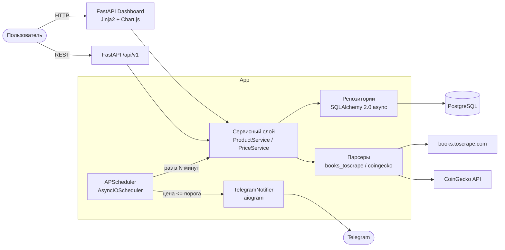

# Price Tracker


[](LICENSE)

Я сделал этот пет-проект, чтобы собрать в одном месте привычный мне стек
(FastAPI + SQLAlchemy 2.0 async + APScheduler + aiogram) на задаче,
которой можно реально пользоваться: сервис следит за ценами, хранит их
историю и шлёт уведомление в Telegram, когда цена падает ниже порога.

Источники данных — только те, где доступ явно разрешён:
[books.toscrape.com](https://books.toscrape.com) (учебный сайт для
парсинга) и публичный API [CoinGecko](https://www.coingecko.com).
Ozon, Wildberries и подобные маркетплейсы я не парсю сознательно —
об этом ниже в разделе «Источники данных».

## Что умеет

- Отслеживание цен товаров с books.toscrape.com и криптовалют CoinGecko.
- Периодический обход всех активных товаров по расписанию
  (интервал настраивается, по умолчанию раз в 3 часа).
- История цен по каждому товару.
- Telegram-алерт, когда цена падает до/ниже целевой
  (с cooldown 24 часа, чтобы не спамить).
- Веб-дашборд: таблица товаров со статусами, карточка товара
  с графиком истории (Chart.js), формы добавления/обновления/удаления.
- REST API `/api/v1` для интеграций и тестов.
- Принудительный refresh товара кнопкой или через API — удобно для демо.

## Архитектура



Слои: `api` (роутеры) → `services` (бизнес-логика) → `repositories`
(доступ к БД) → `models` (SQLAlchemy). Парсеры изолированы за
абстракцией `BaseParser`, планировщик вызывает тот же
`PriceService.refresh_product`, что и API/dashboard.

## Стек

- Python 3.11+, FastAPI, Pydantic v2 + pydantic-settings
- SQLAlchemy 2.0 (async) + asyncpg (Postgres) / aiosqlite (тесты)
- Alembic (async-миграции)
- httpx + BeautifulSoup4 (парсинг), APScheduler 3.x (AsyncIOScheduler)
- Jinja2 + Chart.js (CDN, без сборки фронта)
- aiogram 3.x — только отправка уведомлений (без polling)
- pytest + pytest-asyncio + respx (моки httpx)
- Docker + docker-compose, ruff + black + isort, pre-commit, GitHub Actions

## Структура проекта

```
price-tracker/
├── app/
│   ├── api/            # FastAPI-роутеры: products, health, dashboard
│   ├── services/       # бизнес-логика: ProductService, PriceService
│   ├── repositories/   # доступ к БД: ProductRepository, PriceHistoryRepository
│   ├── models/         # SQLAlchemy: Product, PriceHistory, ProductSource
│   ├── schemas/        # Pydantic: ProductCreate, ProductRead, PricePoint
│   ├── parsers/        # base.py (ABC + исключения), books_toscrape, coingecko
│   ├── notifiers/      # telegram.py (aiogram Bot, только отправка)
│   ├── scheduler/      # jobs.py — периодический обход товаров
│   ├── templates/      # index.html, product.html (Jinja2 + Chart.js)
│   ├── static/         # style.css
│   ├── core/           # config, logging, exceptions
│   ├── db/             # session, base (UTCDateTime)
│   └── main.py         # сборка FastAPI + APScheduler в lifespan
├── alembic/            # async-миграции
├── tests/              # pytest: парсеры, API, дашборд, scheduler/cooldown
├── .github/workflows/  # CI: ruff, black, isort, pytest --cov
├── Dockerfile          # multi-stage, non-root
├── docker-compose.yml  # db (postgres:16) + app
├── Makefile            # up, down, migrate, test, lint, shell-db
└── pyproject.toml      # зависимости + конфиги инструментов
```

## Быстрый старт

```powershell
cp .env.example .env        # или: Copy-Item .env.example .env
docker compose up --build -d
docker compose exec app alembic upgrade head   # или: make migrate
```

Открыть http://localhost:8000 — дашборд. API-документация (Swagger):
http://localhost:8000/docs.

Для локальной разработки без Docker:

```powershell
python -m venv .venv
.\.venv\Scripts\Activate.ps1
pip install -e ".[dev]"
alembic upgrade head         # по умолчанию используется SQLite-файл
uvicorn app.main:app --reload
```

## Источники данных

| Источник | Что такое `external_id` | Валюта | Почему он |
|---|---|---|---|
| books.toscrape.com | полный URL страницы книги | GBP | Учебный сайт, созданный для парсинга: не блокирует, разметка стабильна |
| CoinGecko | coin id (`bitcoin`, `ethereum`, ...) | USD | Бесплатный публичный REST API без ключа |

**Почему не Ozon / Wildberries / Яндекс.Маркет / Avito:** у них жёсткий
anti-bot (блокируют и httpx, и Playwright), нестабильная разметка и ToS,
запрещающие парсинг. Пет-проект на таких источниках ломался бы на каждом
демо. MVP сознательно работает только с источниками, у которых доступ
явно разрешён.

## Переменные окружения

| Переменная | По умолчанию | Описание |
|---|---|---|
| `DATABASE_URL` | `sqlite+aiosqlite:///./price_tracker.db` | Строка подключения SQLAlchemy |
| `POSTGRES_USER` | `pricetracker` | Пользователь Postgres (для compose) |
| `POSTGRES_PASSWORD` | `change_me` | Пароль Postgres (в compose и `DATABASE_URL` должны совпадать) |
| `POSTGRES_DB` | `pricetracker` | Имя БД Postgres |
| `ALERT_BOT_TOKEN` | пусто | Токен Telegram-бота (@BotFather). Пусто — алерты только логируются |
| `SCHEDULER_INTERVAL_MINUTES` | `180` | Интервал обхода товаров, минуты |
| `ALERT_COOLDOWN_HOURS` | `24` | Минимальный интервал между алертами по одному товару, часы |
| `ENVIRONMENT` | `development` | Окружение (логируется при старте) |
| `LOG_LEVEL` | `INFO` | Уровень логирования |

## API

Префикс `/api/v1`. Ошибки — единый JSON: `{"detail": "..."}`.

| Метод | Путь | Описание |
|---|---|---|
| GET | `/health` | `{"status": "ok", "db": "ok", "scheduler": "running"}` |
| GET | `/products` | Список товаров |
| POST | `/products` | Создать товар |
| GET | `/products/{id}` | Карточка товара (JSON) |
| DELETE | `/products/{id}` | Удалить товар (история каскадом) |
| POST | `/products/{id}/refresh` | Принудительно снять цену сейчас |
| GET | `/products/{id}/history?limit=100` | История цен, новые первыми |

Пример создания товара:

```powershell
Invoke-RestMethod -Method Post http://localhost:8000/api/v1/products `
  -ContentType "application/json" `
  -Body '{"name":"Bitcoin","source":"coingecko","external_id":"bitcoin","target_price":"100000","user_telegram_id":123456}'
```

## Тесты

```powershell
make test    # или: pytest --cov=app --cov-report=term-missing --cov-fail-under=70
```

30 тестов: парсеры (успех, таймаут, 403/429 с retry, битая разметка —
всё через respx), CRUD API, дашборд-формы, джоба планировщика
(история, алерт ниже порога, cooldown 24ч, ошибка парсера не роняет
обход). Coverage ~90%, нижняя планка в CI — 70%.

Тесты крутятся на SQLite in-memory (aiosqlite + StaticPool), внешние
источники замоканы — сеть не нужна.

## Known limitations

- Дашборд публичный, без auth — пет-проект, не выставлять в интернет.
- CoinGecko: лимит ~10-30 req/min. При большом числе крипто-товаров
  нужен backoff/батчинг (endpoint `simple/price` умеет несколько ids
  за один запрос — сюда и расти).
- books.toscrape.com — учебный сайт, а не реальный маркетплейс: цены
  там статичны, полезно для демо механики, а не для реальной выгоды.
- Планировщик живёт в одном процессе с API (APScheduler в lifespan).
  При масштабировании нужен отдельный worker (Celery/RQ) и блокировка
  от параллельных запусков.
- Уведомления: cooldown 24ч на товар, без дедупликации по значению цены
  (если цена остаётся ниже порога, алерт придёт снова через сутки).
- Нет пагинации в дашборде — все товары на одной странице.

## Troubleshooting

- **`docker compose exec app alembic upgrade head` падает с
  `connection refused`** — Postgres ещё не поднялся. Дождаться
  `docker compose ps` → `db (healthy)` и повторить.
- **Приложение не видит БД после смены `POSTGRES_PASSWORD`** —
  пароль зашит в volume `postgres_data` при первом старте. Сброс:
  `docker compose down -v` и поднять заново.
- **CoinGecko возвращает 429** — превышен лимит запросов. Парсер сам
  ретраит один раз, но частые refresh многих монет упрутся в лимит:
  увеличить `SCHEDULER_INTERVAL_MINUTES`.
- **`CHECK constraint failed: ck_products_source`** — в `source` можно
  только `books_toscrape` / `coingecko`; для новых источников нужна
  миграция с новым constraint.
- **Алерты не приходят** — проверить `ALERT_BOT_TOKEN` в `.env`
  и что пользователь хотя бы раз нажимал /start у бота (иначе Telegram
  не даёт боту писать первым). Без токена алерты видны в логах app.
- **Пустой график в карточке товара** — история пуста, нажать
  «Обновить сейчас» или дождаться джобы.

## Что дальше

- Playwright-парсер для JS-сайтов (Ozon/WB всё равно остаются вне scope
  из-за ToS и anti-bot).
- Celery + Redis вместо APScheduler — отдельный worker-контейнер.
- Auth в дашборде через Telegram Login Widget.
- Email-алерты через SMTP как второй канал.
- Дедупликация алертов по значению цены и настраиваемый cooldown
  на уровне товара.
- Деплой на VPS: Docker + Caddy (автоматический HTTPS).

## License

[MIT](LICENSE)
